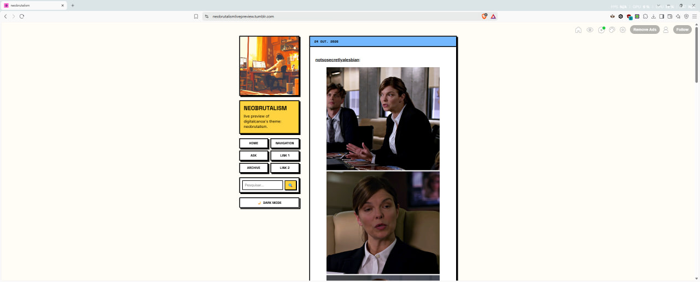
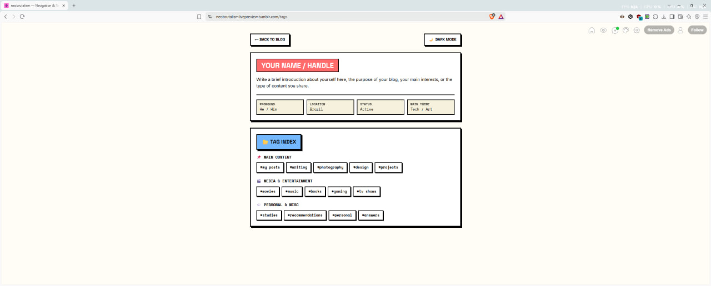
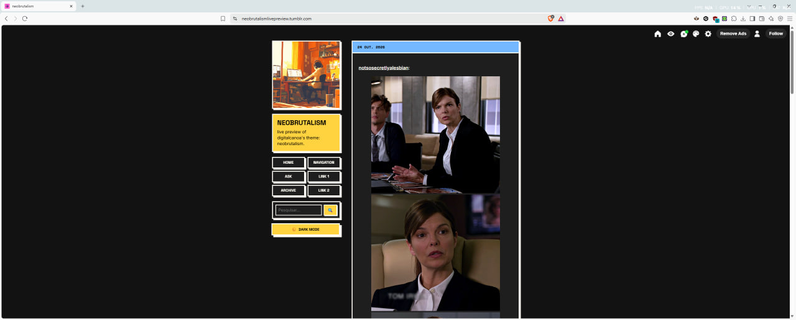
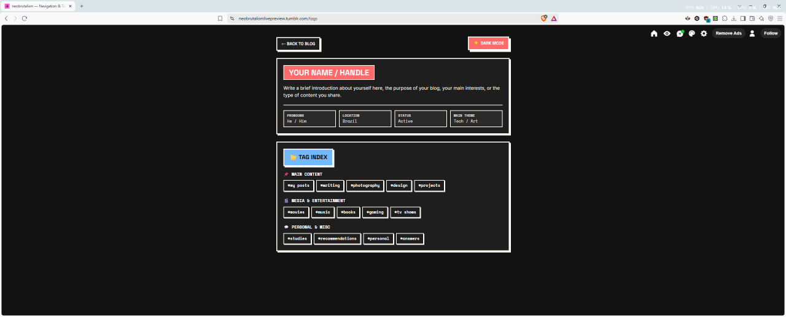

# 🎨 Neobrutalist Tumblr Theme & Custom Navigation Page

[English](https://www.google.com/search?q=%23english) | [Português](https://www.google.com/search?q=%23portugu%C3%AAs)

---

 
 

## English

A lightweight, fully responsive, and media-safe Tumblr theme and matching Custom Navigation Page inspired by the [Neobrutalism web design movement](https://neubrutalism.com/).

### ✨ Features

* **Neobrutalist Aesthetic:** Bold 3px borders, hard zero-blur shadows, high-contrast colors, and sharp corners.
* **Pure CSS Dark Mode:** Toggle dark mode smoothly without any JavaScript (100% compliant with Tumblr's page security rules).
* **Responsive Mobile Design:** Automatic single-column stack on smartphones and tablets with touch-friendly navigation targets.
* **Reblog Media Overflow Fix:** Video embeds (YouTube, Vimeo), photosets, and iFrames are constrained so they never leak outside post cards.
* **Structured Sidebar Layout:**
* Custom Sidebar Image box.
* Blog Title & Description card.
* 2-column x 3-row Navigation Links grid (Home, Ask, Archive, Submit, + 2 Custom Links).
* Built-in Search Bar.
* Dark Mode switch.

* **Matching Custom Tag & Profile Page:** A dedicated standalone page for blogger bio, quick details, and categorized tag navigation.

---

### 🚀 Installation & Usage Guide

#### 1. Installing the Main Theme

1. Log in to Tumblr and go to **Settings** → **Edit Appearance**.
2. Click **Edit HTML** under your custom theme section.
3. Select all existing code and replace it with the provided Main Theme code.
4. Click **Update Preview** and then **Save**.
5. Customize options directly from the left sidebar panel:
* **Sidebar Image:** Upload or paste a custom image URL.
* **Custom Link 1 & 2:** Set custom labels and URLs (e.g., Shop, Portfolio, Spotify).
* **Colors:** Customize background, accent, and post accent colors.

#### 2. Installing the Custom Navigation / Tags Page

1. Go to **Settings** → **Edit Appearance**.
2. Scroll down to the **Pages** section and click **Add a page**.
3. Toggle the option **Custom Layout** (HTML mode).
4. Set the Page URL to `/navigation` or `/tags` (e.g., `[yourblog.tumblr.com/navigation](https://yourblog.tumblr.com/navigation)`).
5. Set the Page Title (e.g., *Nav & Tags*).
6. Paste the provided Navigation Page code into the HTML editor.
7. Click **Save**.

---

### 🛠️ Customization Tips

* **Tags Index:** In the Navigation Page code, find `
` sections and replace the example tags (`#my-posts`, `#writing`, etc.) with your actual blog tags using the format `/tagged/your-tag-name`.
* **Profile Details:** Edit the pronouns, location, status, and main theme fields in the `
` block.

---

---

## Português

Um tema completo para Tumblr e página de navegação combinando, inspirados na tendência de [Web Design Neobrutalista](https://neubrutalism.com/). Totalmente responsivo, otimizado para celulares e seguro contra bloqueios de código do Tumblr.

### ✨ Funcionalidades

* **Estética Neobrutalista:** Bordas pretas marcadas de 3px, sombras duras sem desfoque, cores sólidas e cantos retos.
* **Modo Escuro em CSS Puro:** Alternador de tema escuro funcional sem dependência de JavaScript (100% seguro contra os filtros de segurança do Tumblr).
* **Layout 100% Responsivo:** Reorganização automática para coluna única em celulares e tablets, com áreas de clique otimizadas para toque.
* **Correção de Transbordo de Mídias:** Vídeos embutidos (YouTube, Vimeo), galpões de fotos e iFrames em reblogs são contidos para nunca vazar fora dos cartões de post.
* **Sidebar Estruturada:**
* Bloco de Imagem da Sidebar.
* Cartão de Título e Descrição do Blog.
* Grade de Links em 2 Colunas x 3 Linhas (Início, Ask, Arquivo, Submit + 2 Links Customizáveis).
* Caixa de Pesquisa integrada.
* Alternador de Modo Escuro.

* **Página Customizada de Navegação:** Página dedicada para apresentação do autor (bio, pronome, status) e índice de tags categorizado.

---

### 🚀 Guia de Instalação e Uso

#### 1. Instalando o Tema Principal

1. Acesse o Tumblr e vá em **Configurações** → **Editar Aparência**.
2. Clique no botão **Editar HTML** no painel de personalização do tema.
3. Selecione todo o código antigo e substitua pelo código do Tema Principal fornecido.
4. Clique em **Atualizar pré-visualização** e depois em **Salvar**.
5. Personalize as opções no painel lateral do Tumblr:
* **Imagem de Sidebar:** Envie uma imagem ou insira uma URL customizada.
* **Custom Link 1 & 2:** Defina rótulos e links personalizados (ex: Loja, Portfólio, Redes Sociais).
* **Cores:** Escolha as cores de fundo, destaque e acento dos posts.

#### 2. Criando a Página Personalizada de Navegação / Tags

1. Vá em **Configurações** → **Editar Aparência**.
2. Role até a seção **Páginas** e clique em **Adicionar uma página**.
3. Ative a chave **Layout personalizado** (modo HTML).
4. Defina a URL da página como `/navegacao` ou `/tags` (ex: `[seublog.tumblr.com/tags](https://seublog.tumblr.com/tags)`).
5. Defina o Título da página (ex: *Navegação & Tags*).
6. Cole o código fornecido da Página de Navegação no editor.
7. Clique em **Salvar**.

---

### 🛠️ Dicas de Personalização

* **Índice de Tags:** No código da Página de Navegação, localize os blocos `
` e substitua os exemplos (`#my-posts`, `#writing`, etc.) pelas suas tags reais utilizando a estrutura `/tagged/nome-da-tag`.
* **Ficha de Perfil:** Edite os pronomes, localização, status e tema principal dentro do bloco `
`.
